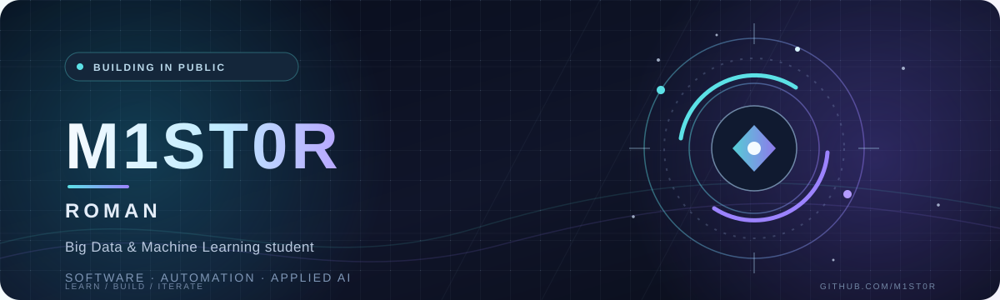

<!-- Profile README — M1ST0R -->

  

<h2 align="center">Hey, I'm Roman 👋</h2>

  <strong>Big Data &amp; Machine Learning student</strong> 
  I enjoy turning ideas into practical software — from desktop tools and automation to small products and experiments

---

## ✦ A little about me

- 🎓 Studying **Big Data &amp; Machine Learning**
- 🛠️ Building desktop applications, automation tools and browser-based projects
- 🧠 Interested in **applied AI, local models, data engineering and useful developer tools**
- 🔍 I like understanding how things work under the hood — and improving them one iteration at a time

## 🚀 Selected projects

### [Hethereau Hobbies Tool](https://github.com/M1ST0R/hethereau-hobbies-tool)

A modular desktop toolkit for automating repetitive activities in **Neverness to Everness**. Built with Python and PySide6 / Qt Quick (QML), with OCR, window-aware input and a live control dashboard

### [ProCraft — Community Localization](https://github.com/M1ST0R/procraft_localization)

A community localization proposal for ProCraft: a documented language-pack format, contributor guidance and a foundation for user-created translations

### [Pivot — Startup Tycoon](https://github.com/M1ST0R/startup_tycoon)
A browser-based management game about growing one IT startup: hire a team, develop a product, attract customers and keep the company financially healthy

---

## 🧰 Tools & technologies

  
  
  
  
  
  
  
  

## 🧭 What I'm exploring

**Machine learning · Data engineering · Local AI · Desktop UX · Automation architecture**

I’m especially interested in connecting these areas to build software that is useful, reliable and pleasant to use

## 📊 GitHub at a glance

  
  

---

## 💬 Find me

  

  Thanks for stopping by. Have a great day — and keep building cool things ✨

